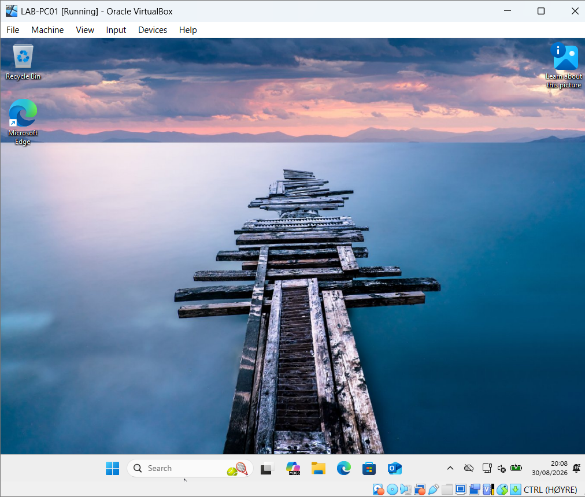
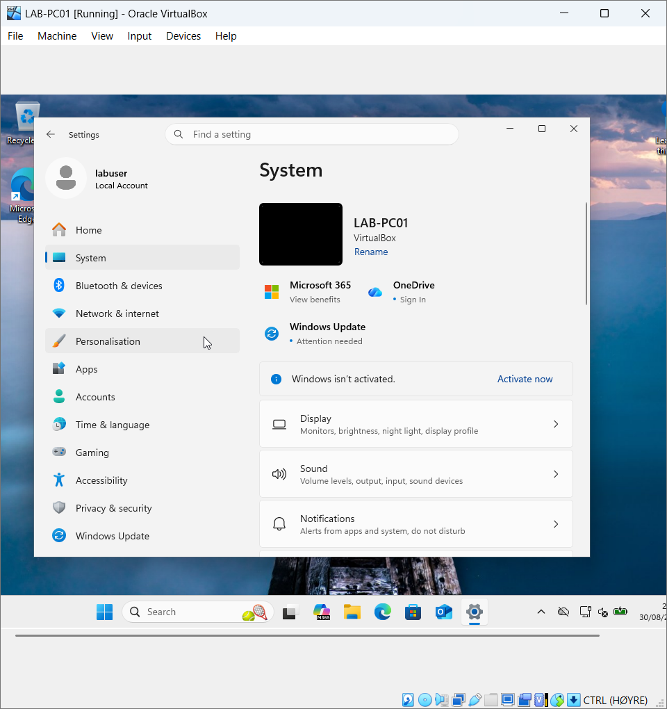
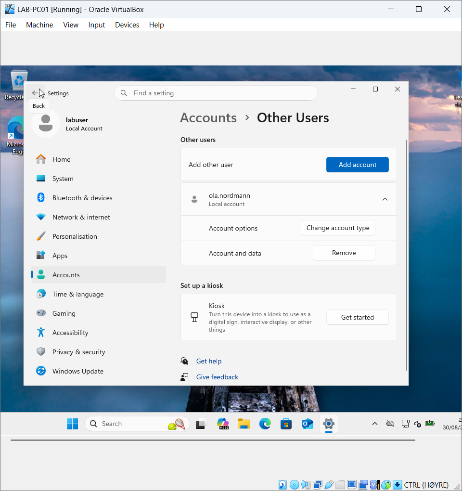
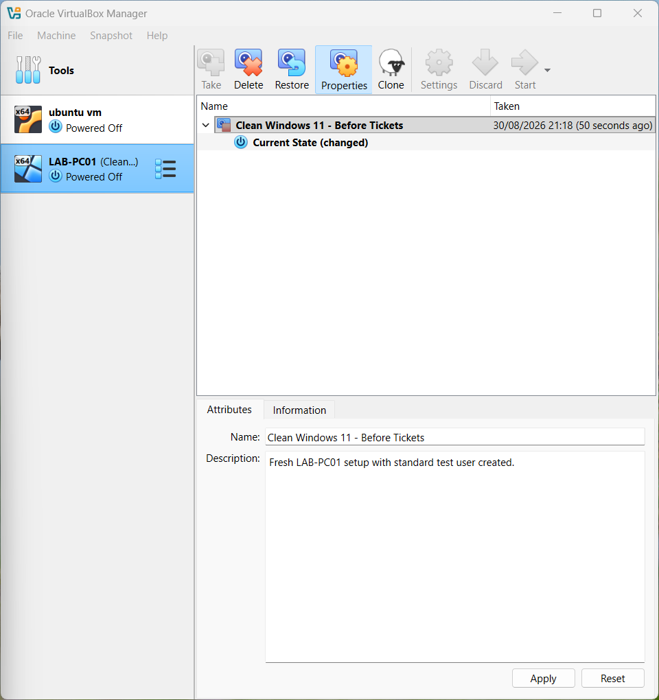

# Windows 11 Virtual Machine Setup

## Project Overview

This project documents the installation and configuration of a Windows 11 virtual machine using Oracle VirtualBox.

The goal is to develop hands-on skills in Windows administration, virtualization, local user management, and IT support.

This lab is part of my practical IT Support and Infrastructure learning portfolio.

## Tools and Technologies

- Oracle VirtualBox
- Windows 11
- Windows Settings
- VirtualBox Snapshots

## Lab Setup

### 1. Windows 11 Installation

Installed Windows 11 in Oracle VirtualBox and verified that the operating system boots successfully.

### 2. Computer Configuration

Configured the virtual machine with the hostname `LAB-PC01` to simulate a workstation in a business environment.

### 3. Local User Management

Created a local standard user account named `ola.nordmann` to simulate an employee account.

This provides a foundation for future user management and troubleshooting exercises.

### 4. Virtual Machine Snapshot

Created a VirtualBox snapshot named `Clean Windows 11 - Before Tickets`.

This snapshot provides a recovery point that can be used to restore the virtual machine to its initial configuration.

## Skills Practiced

- Windows 11 installation and configuration
- Virtual machine management using VirtualBox
- Computer naming and system configuration
- Local user account management
- Snapshot creation and recovery planning
- Technical documentation

## Challenges Encountered

During the lab, I encountered storage limitations that prevented software from downloading successfully.

This issue will be investigated and documented in a separate troubleshooting exercise.

## Project Status

**Initial setup: Completed**

The Windows 11 virtual machine is configured and ready for further IT support and troubleshooting exercises.

## Next Steps

- Investigate and resolve storage issues
- Practice Windows troubleshooting
- Explore networking and connectivity
- Document realistic IT support incidents
